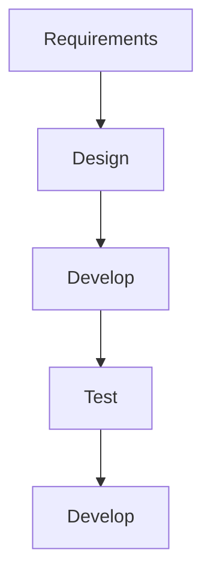
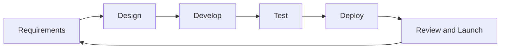
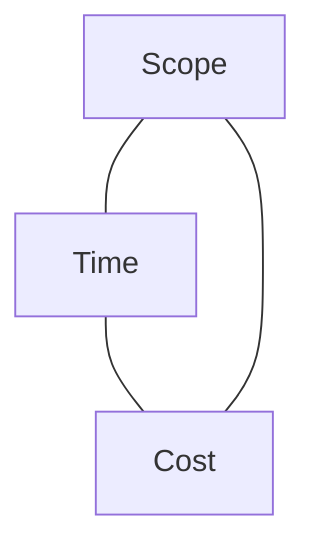

# **5 November 2026, 11:16**

---

## Project Management

This is a temporary endeavour to create a unique result.

**Temporary**: definite beginning and definite end.

**Unique**: the output is different from others in some way.

**Drive change**: projects are the primary way organisations transition from one state to another.

## Projects Follow a Linear Sequential Path

- **Initiation**: defining the project and obtaining formal authorization to start.
- **Planning**: establishing the total scope, objectives and the roadmap.
- **Execution**: carrying out the work defined in the project plan.
- **Monitoring and control**: tracking, reviewing and regulating progress.
- **Closing**: completing all activities, archiving records and handing over the final result.

### Waterfall Diagram

## The Agile Model

## The Iron Triangle

Scope, time and cost form the iron triangle.

- **Scope**: the specific goals, deliverables and tasks that define the boundaries of the project.
- **Time**: the schedule and deadlines required to complete the project activities and milestones.
- **Cost**: the financial resources, budget and human capital allocated to execute the project.

## The PMBOK Guide

PMBOK stands for Project Management Body of Knowledge. The guide provides a global standard for the profession.

| Principles | Domains |
| --- | --- |
| **Stewardship**: be a diligent, respectful and caring steward of resources | **Stakeholders**: engage with stakeholders to maintain alignment |
| **Team**: create a collaborative project team environment | **Planning**: develop an approach to organize and coordinate work |
| **Value**: focus on outcomes and realization of project value | **Project work**: establish processes and manage physical resources |

## CAPM

Certified Associate in Project Management (CAPM) is an entry-level certification designed for those new to the field. It validates your foundational knowledge of project management terminology and global standards.

| Item | Detail |
| --- | --- |
| **Validation** | Foundational knowledge of project management terminology and core concepts defined in the PMBOK guide |
| **Pathway — requirements** | Secondary degree (high school diploma/GED) + 23 hours of project management education |
| **Pathway — methodologies** | Covers predictive (waterfall) methodologies, agile frameworks and business analysis |
| **Pathway — exam focus** | 150 questions over 180 minutes, testing fundamentals and practical application |

## Stakeholders and Governance

Stakeholders are anyone impacted by the project outcome.

Governance provides the framework for decision making.

| Structure | Oversight |
| --- | --- |
| **Policies and processes**: standardised methods for managing risk, quality and communication | **Accountability**: ensure the project remains aligned with the organizational strategy |
| **Roles and responsibilities**: clear definition of who makes decisions and who is accountable | **Escalation**: defining how and when to move critical issues to higher management |

## Class Exercise: Project vs Operations

Scenarios:

1. Upgrading the university's WiFi across all campuses.
2. Answering student emails at the registrar's office.
3. Designing and launching a new student orientation app.

Tasks:

1. Classify — identify which are projects vs operations, based on core traits.
2. Stakeholders — for the projects, identify at least three key stakeholders.
3. Constraints — discuss the likely triple constraint priorities for each.
