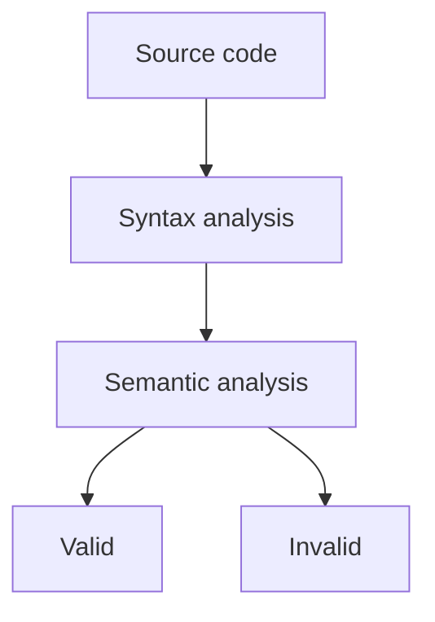
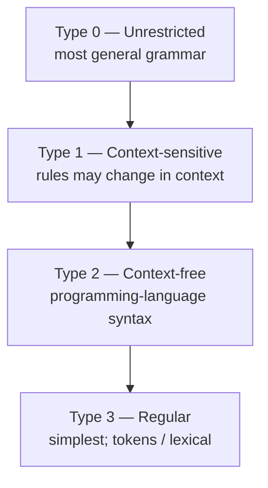

# **4 November 2026, 12:35**

---

## The Compiler and the Interpreter

The compiler translates the entire source code at compile time, but the interpreter translates the source code line by line at run time.

## Data Structures Used in Compilers

- **Stack**: supporting function calls.
- **Tree**: representing program structure and expressions.
- **Hash table**: implementing efficient symbol table lookup.
- **Graph**: representing control flow and data flow relationships.
- **List or array**: storing tokens, instructions and sequences.

## Symbol Table

This is a data structure used by a compiler to store and manage information about identifiers, such as variable names, function names, constants and classes.

## Introduction to Compiler Architecture

Compiler architecture refers to the internal organisation of a compiler: the different stages, components, data structures and processes that work together to translate a program correctly and efficiently.

## Example Code Snippet

```c
int a = 5;
int b = 3;
int sum = a + b;
```

## Illustration: The Compiler as a Factory

Imagine a factory that produces bags. The work is divided into different departments: one department receives the raw materials, another checks the materials, another assembles the parts, another checks the finished product, and another packages the final product.

## The Phases of a Compiler

Starting from the source code — the program written by the programmer:

| Phase | What it does |
| --- | --- |
| Lexical analysis | Breaks the characters into tokens |
| Syntax analysis | Checks the structure of the tokens |
| Semantic analysis | Checks whether the program makes sense |
| Intermediate code generation | Produces a simpler internal representation |
| Code optimization | Looks for safe ways to improve the code |
| Target code generation | Produces instructions for the target system |

## Difference Between a Token and a Lexeme

- A **lexeme** is the actual text found in the program.
- A **token** is the category assigned to that text.

The scanner does not output text; it outputs pairs of `(token category, lexeme)`.

Using the snippet above:

| Lexeme (text) | Token (category) |
| --- | --- |
| `int` | KEYWORD |
| `a` | IDENTIFIER |
| `=` | ASSIGN_OP |
| `5` | INT_LITERAL |
| `;` | SEMICOLON |
| `b` | IDENTIFIER |
| `3` | INT_LITERAL |
| `sum` | IDENTIFIER |
| `a` | IDENTIFIER |
| `+` | PLUS_OP |
| `b` | IDENTIFIER |
| `;` | SEMICOLON |

Key points:

- Many lexemes can share one token: `a`, `b` and `sum` are three different lexemes but all carry the token IDENTIFIER.
- One lexeme can be a different token in a different place: `int` is a KEYWORD, not an IDENTIFIER.
- Two lexemes can share a token but carry different values: `5` and `3` are both INT_LITERAL, with the number kept as the value.

The **pattern** is the rule that decides which category a lexeme belongs to — for example `[a-zA-Z_][a-zA-Z0-9_]*` is the pattern that turns the lexeme `sum` into the token IDENTIFIER.

## Syntax and Semantic Analysis

**Syntax analysis**: checks whether the tokens are arranged according to the grammar rules of a programming language.

**Semantic analysis**: checks whether the expressions and variable declarations obey the language rules.



## Formal Grammar

This is a mathematical system of production rules that defines how valid expressions and statements are formed in a language.

It is used in compiler construction because it provides the foundation for syntax analysis and enables the parser to distinguish correctly structured programs from syntactically invalid ones.

## Importance of Formal Grammar

- Defines the legal structure of programming statements.
- It helps the parser recognise valid and invalid expressions.
- It provides a foundation for syntax analysis.
- It helps programmers and compiler designers describe programming languages precisely.
- It supports the creation of algorithms and data structures.

## Mathematical Representation of Formal Grammar

This is the formula:

```
G = (N, T, P, S)
```

| Symbol | Component | Meaning |
| --- | --- | --- |
| `N` | Non-terminals | e.g. `expression` |
| `T` | Terminals | |
| `P` | Production rules | |
| `S` | Start symbol | |

## Example of Formal Grammar

```
expression → number + number

number → 0 | 1 | ... | 9
```

- `expression` is a non-terminal.
- `number` is also a non-terminal.
- `+` and the individual digits are terminals.
- The arrows are the production rules.

## Chomsky Hierarchy

This is the classification of formal grammars into four types, based on the restrictions placed on their production rules and the kind of languages they can describe.

It was introduced by the linguist and computer scientist Noam Chomsky.

## Chomsky Hierarchy Diagram



| Type | Grammar | Language it describes | Recognised by | Where it is used in a compiler |
| --- | --- | --- | --- | --- |
| 0 | Unrestricted | Recursively enumerable | Turing machine | — |
| 1 | Context-sensitive | Context-sensitive | Linear-bounded automaton | — |
| 2 | Context-free | Context-free | Pushdown automaton | Syntax analysis (the grammar you write for a parser) |
| 3 | Regular | Regular | Finite-state automaton | Lexical analysis (tokens) |
