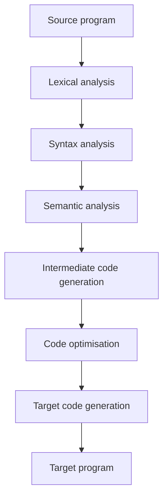
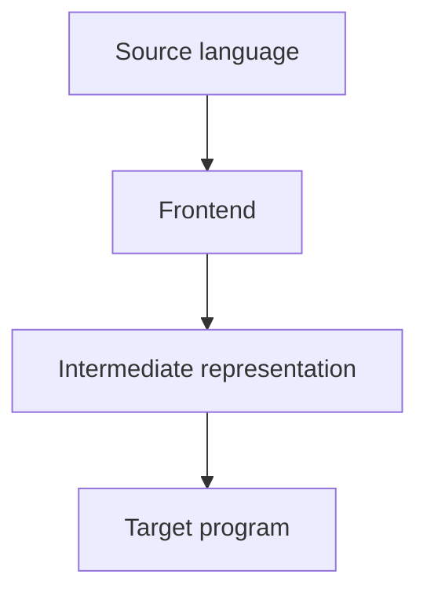

# **11 November 2026, 11:37**

---

## Intermediate Code Generation

Intermediate code generation is the process of translating a program's analyzed structure — the output of semantic analysis — into a simpler, machine-independent internal form called intermediate code or intermediate representation (IR). Later stages of the compiler work from that IR to produce the target machine code.

## Functions of Intermediate Code

- Optimize expressions.
- Analyze program behaviour.

## Code Optimization

| Technique | Simple meaning |
| --- | --- |
| Constant folding | Calculate constant expressions early. |
| Constant propagation | Replace a variable ... |

## Target Code Generation

Target code generation translates the intermediate instructions into instructions that a target system can understand.

## After Code Generation

The generated code may be assembled into an object file and then linked with other object files and libraries to create an executable.

## Phases of Compiler Construction

## Analysis-Synthesis Model

The analysis-synthesis model is a fundamental way of understanding ...

The analysis phase examines the source program to determine its structure and meaning.

This is commonly called the **frontend** of the compiler. It is dependent on the source programming language, but it is designed to minimize dependence on the target hardware.

**Example:** a C++ frontend understands C++ syntax and semantics, and it can potentially support several target processors.

### Responsibilities of the Analysis Phase

- Identifying tokens through lexical analysis.
- Checking grammatical structure through syntax analysis.
- Checking declarations, types and other semantic rules.
- Producing an intermediate representation suitable for later processing.

## Synthesis Phase

The synthesis phase constructs the target program from the information produced during analysis. It is commonly called the **backend**. It is dependent on the target architecture: it must understand the instruction set, the registers and the other relevant characteristics of that architecture.

### Responsibilities of the Synthesis Phase

- Selecting appropriate target instructions.
- Allocating registers and memory locations where necessary.
- Applying target-specific optimisation.
- Producing assembly code or machine code object files.

## Intermediate Representation and Code Reuse

The intermediate representation separates the frontend from the backend. This separation supports code reuse: if a compiler system supports three source languages and four target architectures, a good IR may reduce the need to develop twelve entirely separate language-to-machine translation systems. It is possible for the system to use three frontends and four backends, provided the frontend and backend agree on the IR, the required language and the platform features.

## Middle End

A practical compiler may contain a **middle end** that performs optimisations on the intermediate representation. A modern architecture is therefore described as the frontend, the middle end and the backend.

## Architecture Diagram

## Compiler Phases and Passes

| Phase | Pass |
| --- | --- |
| A logical compilation activity. | A traversal or processing cycle. |
