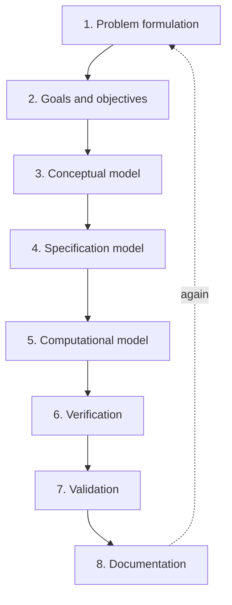

# **24 November 2026, 09:19**

---

## Classification of Models

- Discrete.
- Continuous.
- Dynamic.
- Static.
- Deterministic.
- Stochastic.
- Agent based.
- Mathematical.
- Hybrid.

The most important ones, per the lecturer: the first two and the last three — discrete, continuous, agent based, mathematical and hybrid.

## Queueing Theory

Queueing theory is when we try to organise a customer getting access to a resource, no matter how small it is.

### The Two Discrete Events

- Arrival.
- Departure.

## Agent-Based Models

An agent-based model has an environment, a set of actions each agent can take, and rules for when it acts. Each agent decides alone, and the overall behaviour comes out of them interacting. Some agents chase a goal and search for the best action — that is one kind of agent, not a requirement.

## Mathematical Models

A mathematical model describes the system with equations: variables, and the relationships between them.

Example: `s = v × t` — distance, speed and time, one relation, and the answer comes from arithmetic.

## Generic Model Development Lifecycle

It is an iterative process: you go round the loop more than once.

## Conceptual Model

- An abstract representation of the system.
- What goes in? What stays out? At what level of detail?
- Which entities matter? The right choice depends on the purpose.

## Specification Model

- The conceptual model with the specifics filled in.
- Collect the data that populates it: empirical data or fitted distributions.
- Traffic: road geometry, signal timing, demand. Networks: topology, message sizes, arrival rates.

## Verification

- Did I build the model right?
- Does the program match the specification model? Debugging belongs here.
- Techniques: trace a few entities by hand, walk through the code with a peer, run a simplified case you can compute, compare with M/M/1.
