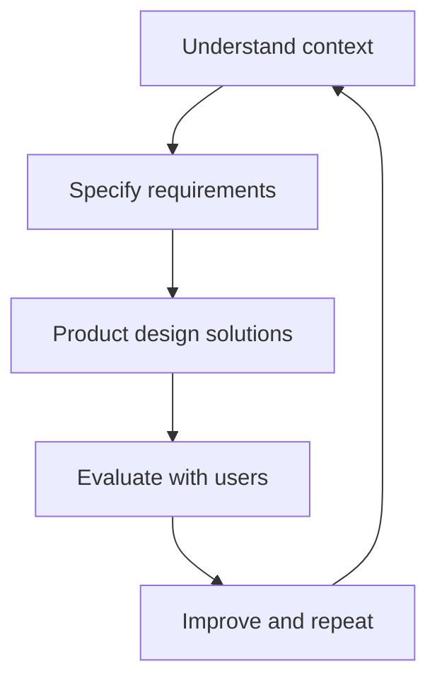

# **16 November 2026, 11:25**

---

## User-Centered Design

### Definition

It is an iterative approach to designing interactive systems in which the needs, goals, abilities and context of intended users guide decisions throughout development.

### Core Principles of UCD

- Early user focus.
- Understand the whole experience.
- User-centered evaluation.
- Iterative design.
- Multidisciplinary work.
- Inclusive and accessible design.

## Identification of Stakeholders

A stakeholder is anyone who has an interest in, is affected by, or can affect the output of a project.

Also defined as a person or organization with an interest in, influence over, or impact from the system. Example: the Vice Chancellor of the school.

### Direct User

A person who interacts with the system to complete a task.

Example: a student registering courses, a registry officer.

## Functional Requirements

What the system must do.

- **FR1** — Authentication.
- **FR2** — Course registration.
- **FR3** — Registration confirmation.
- **FR4** — Academic records.
- **FR5** — Timetable.
- **FR6** — Academic support.

## The User-Centered Design Process

- **Understand context:** observe user groups, devices, constraints.
- **Specify requirements:** convert research into prioritised user needs, task flows, functional requirements and quality criteria.
- **Product design solutions:** sketch journeys, create wireframes and build a clickable prototype of key screens.
- **Evaluate with users:** ask representative users to complete realistic tasks.
- **Improve and repeat:** fix high-impact problems, retest changes and continue iterating before and after launch.

