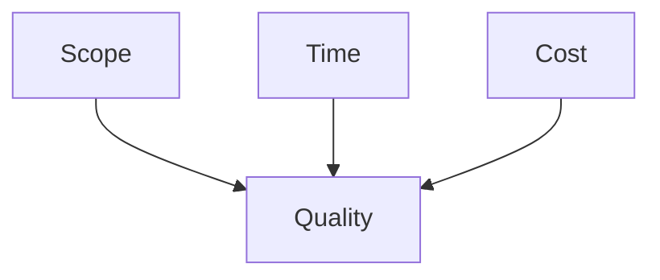
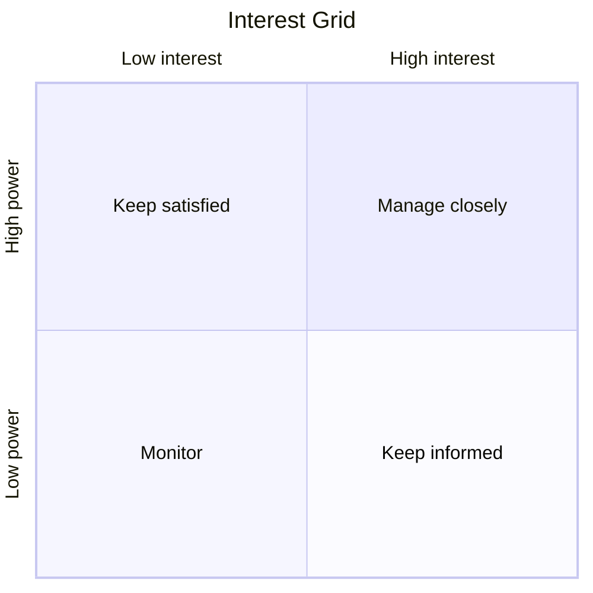
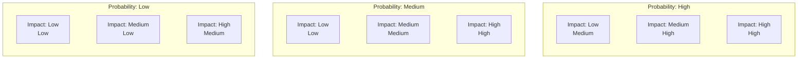

# **4 November 2026, 15:12**

---

## What Is a Project?

A project is an undertaking to carry out a set of activities to achieve a certain objective, with the allocated resources, within a set period of time.

## Key Components

- Objective
- Duration
- Resources
- Deliverable

## Project vs Operation

An operation is ongoing, but a project is temporary.

## Project Management

Project management is the application of knowledge, skills, tools and techniques to project activities to meet project requirements.

## Key Components of Project Management

- Scope
- Resources
- Schedule
- Budget
- Quality
- Control

## Triple Constraint and Quality

If scope grows, time shrinks and cost is capped.

## The Ten Characteristics of a Project

1. Clear objectives
2. Definite beginning and end
3. Unique deliverables
4. Unrelated activities
5. Limited resources
6. Stakeholders
7. Uncertainty and risk
8. Definite budget and schedule
9. Coordination and control
10. Completion and evaluation

## Stakeholder

A stakeholder is a person, a group or an organization that can affect a project, be affected by it, or have an interest in its outcome.

## The Interest Grid

## Uncertainty and Risk Matrix

